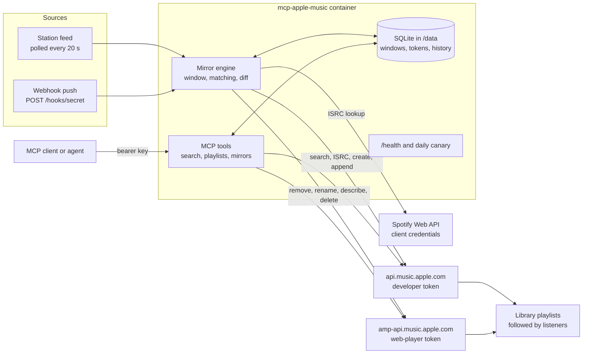
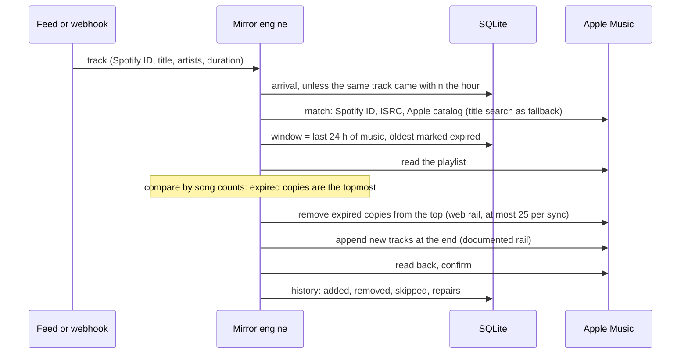
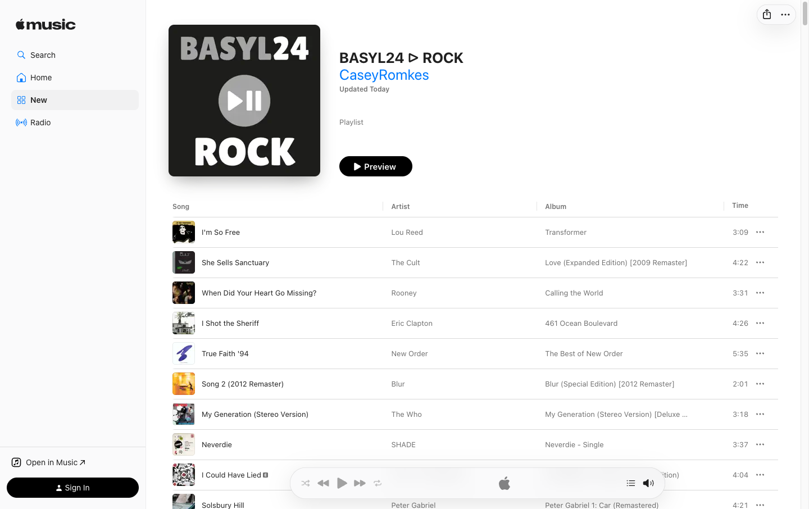
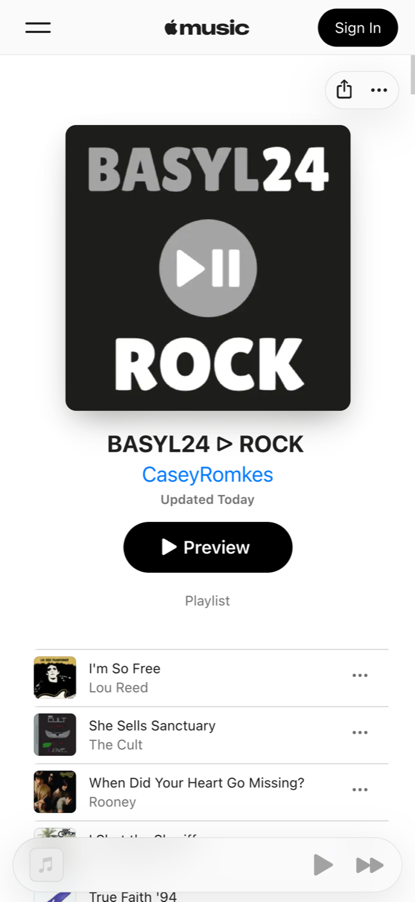

# Architecture

One container does two jobs: it serves MCP tools for an agent, and it runs the mirror
loop that keeps playlists equal to a station's last 24 hours. Both share one SQLite file
and two ways into Apple Music.

## Two rails into Apple Music

| Rail | Host | Credential | Used for |
|---|---|---|---|
| `api` | api.music.apple.com, documented | Developer token signed with your MusicKit key, plus the Music User Token | Search, ISRC lookup, reading playlists, creating playlists, appending tracks |
| `web` | amp-api.music.apple.com, the web player's own API | Token from the web player's public JavaScript bundle, plus the Music User Token | Removing tracks, renaming, describing and deleting playlists, track counts |

The documented API can only add. A rolling window must also remove, and only the web
player's API does that from a server. Why we accept that, and what happens if Apple closes
it: [ADR 0001](decisions/0001-web-player-rail.md). Every write names the rail that carried
it, and one module ([apple_web.py](../src/mcp_apple_music/apple_web.py)) holds every web
call, so a break stays contained: removals pause, everything else keeps working.

## Writes are checked by their effect

Apple answers `204` and sometimes does something slightly different. So every add and
removal re-reads the playlist ([library.py](../src/mcp_apple_music/library.py)):

- An add is confirmed when the playlist grew by exactly the requested songs at the end,
  with everything before them unchanged. The IDs Apple lists there are the ones the mirror
  keeps, because Apple may put the library's own copy of a song in (another release, or one
  that has left the catalog) instead of the catalog song that was sent.
- A removal is confirmed when the song's count went down. Copies of a song share one ID,
  and Apple removes the topmost copy (`mode=first`).

## One sync of a mirror

- **The window is measured in music, not wall time:** tracks stay while their durations add
  up to 24 hours. A track Apple lacks still counts toward the length, so the window matches
  the station even when the playlist is missing a song.
- **Every sync compares the whole playlist with the window**, so the hourly reconcile is
  the same sync with nothing new. Anything other than an expiry or an arrival is a repair:
  a song added by hand is removed, a lost one is added back, and both are logged. A
  difference of more than ten tracks is refused as a likely bad read.
- **Order is never changed:** new tracks go at the end, expired ones leave from the top.
- **Taking over an existing playlist** (`playlist_id` in the mirror's config) keeps its link
  and followers. Its tracks become the oldest part of the window and leave one by one as new
  ones arrive.

## Sources

- **Feed:** a JSON URL returning the newest track, or a list. Polled every 20 seconds.
  Redirects are followed every time, so a station that moves to a new address keeps working.
- **Webhook:** the station pushes each track to `POST /hooks/<secret>`, so nothing is missed
  between polls. A track that arrives by both within an hour counts once.
- **Spotify owner login:** a Spotify playlist read with its owner's sign-in. Planned, not
  built.

## State

One SQLite file in `/data`, the only volume:

- **Credentials:** the Apple Music sign-in (Music User Token) and single-use sign-in links.
- **Ownership:** the playlists this server may edit, recorded when it creates one or a mirror
  adopts one.
- **Mirrors:** each window entry is one occurrence of a track. A song played twice a day is
  two entries.
- **Match cache, feed cursors,** the canary result, and 30 days of history per mirror.

Secrets live in the environment, never in the mirrors file.

## Running it

| | Self-hosted ([SELF-HOSTING.md](../SELF-HOSTING.md)) | Behind a tunnel |
|---|---|---|
| Compose file | `compose.yaml`, published image | `compose.build.yaml`, built from source on each push |
| Reachable at | `127.0.0.1:8000`, this machine only | a private address, published through a tunnel with an access gate |
| Public paths | none needed | `/health`, `/hooks/*` (the secret is in the path) and `/auth/*` (single-use links) bypass the gate; everything else needs the gate and the bearer key |

The reference deployment runs the second shape. Gatus checks `/health` and the canary, and
`mirror_audit` keeps the record of what each mirror did.

## What the outcome looks like

